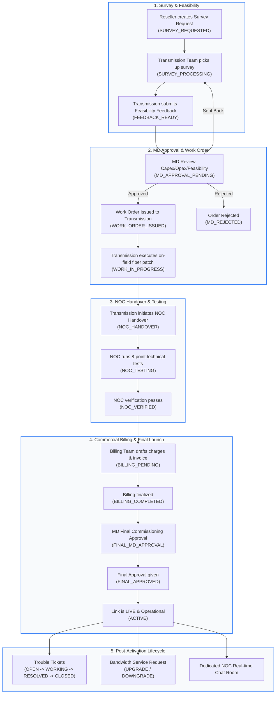
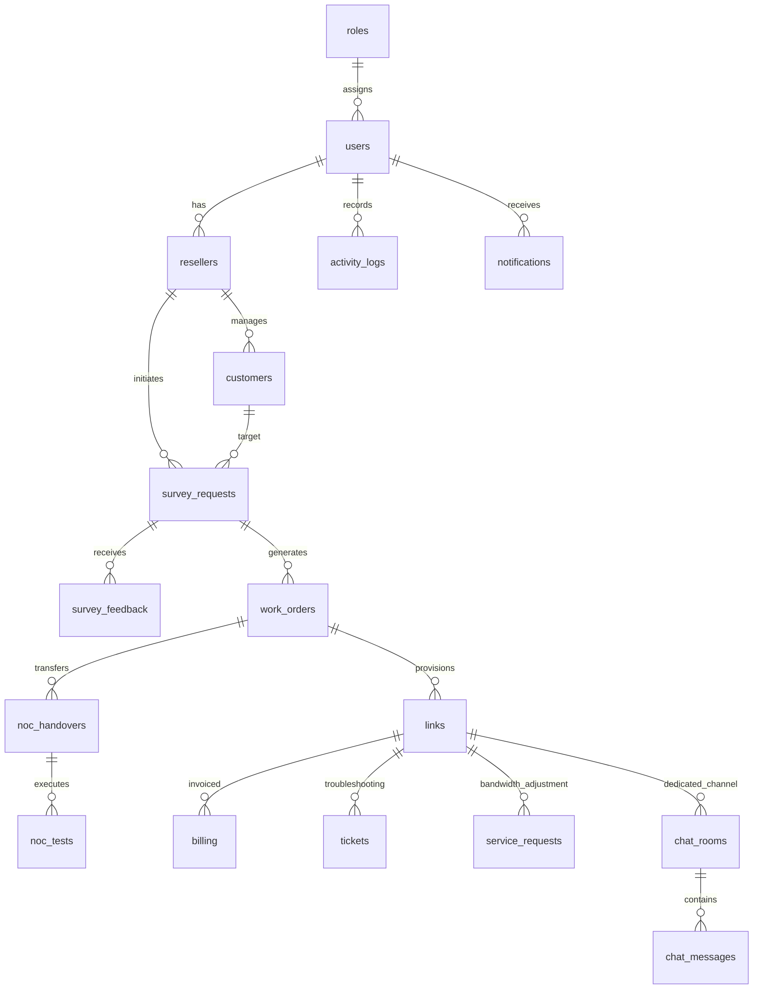

# NTTN Service Management Portal — MVP Architectural Analysis & Implementation Plan

> [!NOTE]
> This document provides an in-depth breakdown of the NTTN Service Management Portal based on [README.md](file:///c:/Users/Dell/Downloads/nttn_portal_mvp/nttn_portal_mvp/README.md), [WORKFLOW.md](file:///c:/Users/Dell/Downloads/nttn_portal_mvp/nttn_portal_mvp/WORKFLOW.md), and [database.sql](file:///c:/Users/Dell/Downloads/nttn_portal_mvp/nttn_portal_mvp/database.sql). It outlines the domain model, state transitions, role-based matrix, and an execution roadmap.

---

## 1. Executive Summary & Domain Scope

The **NTTN (Nationwide Telecommunication Transmission Network) Portal** is a mission-critical B2B service delivery, transmission management, and operational provisioning portal. It connects:
- **Resellers (ISPs / Enterprise Clients)** requesting fiber connectivity and bandwidth.
- **Transmission Engineers** conducting physical feasibility, optical fiber distance mapping, POP/VLAN/Port allocation, and cost estimation.
- **Managing Director (MD)** reviewing commercial viability, Capex/Opex costs, margins, and approving work orders and final handovers.
- **NOC (Network Operations Center)** verifying physical patch, optical power levels, ping, latency, jitter, packet loss, and link health monitoring.
- **Billing Department** generating initial installation invoicing, establishing recurring monthly billing cycles, and monitoring payment readiness.
- **Support & Incident Teams (Trouble Ticketing)** handling after-sales issues, link degradation, bandwidth upgrades/downgrades, and real-time NOC chat.

---

## 2. Complete End-to-End Workflow Diagram

---

## 3. Role-Based Access Control (RBAC) Matrix

| Module / Feature | Super Admin | Reseller | Transmission | MD (Management) | NOC Team | Billing Team |
| :--- | :---: | :---: | :---: | :---: | :---: | :---: |
| **Manage Users & Roles** | Full Access | No | No | Read Only | No | No |
| **Customer Profiling** | Full Access | Own Customers | View | View | View | View |
| **Submit Survey Request** | Yes | Yes (Own) | No | No | No | No |
| **Transmission Feedback** | View/Edit | View (Sanitized) | Create / Edit | View | View | View |
| **MD Financial Approval** | Override | No | No | Approve / Reject / Send Back | No | No |
| **Work Order Management** | Full Access | View Status | Update Progress | View | View | View |
| **NOC 8-Point Verification** | View/Edit | View Summary | View | View | Full (Pass/Fail) | No |
| **Billing & Invoicing** | View/Edit | View Invoices | No | View / Final Approve | No | Full Create/Edit |
| **Final Activation Sign-off**| Override | View | View | Approve / Reject | View | View |
| **Trouble Ticketing (TT)** | Full Access | Create/View Own | Assigned Fixes | View Metrics | Manage / Resolve | No |
| **Bandwidth Up/Downgrade** | Full Access | Request (Own) | Field Check | Approve | Re-provision | Adjust Rate |
| **NOC Live Chat Room** | Monitor | Participant | Participant | Monitor | Participant | No |
| **Audit Activity Log** | Full Audit Trail | Filtered Own | Filtered Own | Full Audit Trail | Filtered Own | Filtered Own |

---

## 4. Database Architecture & Entity Relationships

The schema in [database.sql](file:///c:/Users/Dell/Downloads/nttn_portal_mvp/nttn_portal_mvp/database.sql) provides 17 tables structured into 6 primary relational clusters:

### Key Entity Specifications:
1. **`survey_requests` & `survey_feedback`**:
   - Captures bandwidth requirement, preferred NTTN, coordinates (lat/long), district, and thana.
   - Feedback tracks feasibility (binary), optical distance (`fiber_distance_km`), nearest POP, VLAN, port, installation cost, monthly recurring cost, and estimated delivery timeline.
2. **`approvals` & `work_orders`**:
   - Polymorphic approval logging (`entity_type`, `entity_id`, `approval_stage`) preserving MD review history, timestamps, and remarks.
   - Work order issues clear deadlines and instructions to assigned transmission field engineers.
3. **`links`, `noc_handovers`, & `noc_tests`**:
   - `links` is the core asset entity with `link_id`, `circuit_id`, `nttn_provider`, `vlan`, and operational `status`.
   - `noc_tests` validates an 8-point SLA test suite:
     - 1. Physical Link (`physical_link`)
     - 2. Optical Power (`optical_power`)
     - 3. VLAN Tagging (`vlan_ok`)
     - 4. Bandwidth Throughput (`bandwidth_ok`)
     - 5. ICMP Ping (`ping_ok`)
     - 6. Latency Thresholds (`latency_ok`)
     - 7. Packet Loss (`packet_loss_ok`)
     - 8. NMS Monitoring Onboarding (`monitoring_ok`)
4. **`billing` & `activity_logs`**:
   - Manages installation charges, monthly charges, carrier costs, and payment cycles.
   - `activity_logs` acts as an immutable audit trail recording every state change (`from_status` -> `to_status`), user ID, entity type, and remarks.

---

## 5. Step-by-Step Implementation Roadmap

```mermaid
gantt
    title NTTN Portal MVP Implementation Timeline
    dateFormat  X
    axisFormat Phase %s
    section Phase 1: Foundation
    Environment Setup, Laravel Scaffolding & DB Migrations :0, 2
    RBAC, Authentication, User Management & Seeders         :2, 4
    section Phase 2: Core Survey Flow
    Reseller & Customer Portals                             :4, 6
    Survey Request & Transmission Feasibility Engine        :6, 9
    MD Review & Work Order Dispatch                         :9, 11
    section Phase 3: NOC & Billing
    Transmission Field Workflow & NOC Handover              :11, 13
    NOC 8-Point Testing Suite & Sign-off Engine             :13, 15
    Billing Generation & MD Final Activation Sign-off       :15, 17
    section Phase 4: Operations
    Active Link Repository & Lifecycle Management           :17, 19
    Trouble Ticket (TT) Management & Escalation Engine       :19, 21
    Bandwidth Upgrade / Downgrade Workflow                  :21, 23
    section Phase 5: Communication & Analytics
    Live NOC Chat (WebSockets/Reverb)                       :23, 25
    In-App Notifications, Audit Activity Logs & Dashboard    :25, 27
```

### Detailed Phase Breakdown:

### Phase 1: Project Scaffolding & Security Architecture
- Initialize Laravel 12 application with clean modular directory layout.
- Transform [database.sql](file:///c:/Users/Dell/Downloads/nttn_portal_mvp/nttn_portal_mvp/database.sql) into standard Eloquent Migrations and Factory seeders (with default roles, super admin, and demo accounts for each role).
- Implement Authentication (Laravel Breeze / Fortify with custom RBAC middleware / Laravel Gates & Policies).
- Standardize layout templates (Clean, responsive dashboard UI with modern TailwindCSS, dark/light capability, and consistent navigation per role).

### Phase 2: Customer Onboarding, Survey Lifecycle & MD Work Orders
- **Reseller Module**: Profile management, customer directory with geolocation (District, Thana, Lat/Long).
- **Survey Module**:
  - Reseller initiates `SURVEY_REQUESTED`.
  - Transmission engineers see inbox of pending surveys (`SURVEY_PROCESSING`).
  - Transmission submits physical feasibility details, route, fiber distance, POP, VLAN, and cost calculations (`FEEDBACK_READY`).
- **MD Commercial Review**:
  - Dedicated MD Executive Approval dashboard comparing installation cost vs. expected revenue.
  - Actions: Approve (`MD_APPROVED` -> auto-triggers Work Order), Reject (`MD_REJECTED`), or Send Back with comments (`SENT_BACK`).
- **Work Order Management**: Assignment to field engineers with deadline tracking (`WORK_ORDER_ISSUED` -> `WORK_IN_PROGRESS`).

### Phase 3: NOC Technical Verification & Billing Clearance
- **Transmission to NOC Handover**: Transmission marks field cable/jointing complete and initiates handover (`NOC_HANDOVER`).
- **NOC Testing Workbench**:
  - Interactive 8-point checklist with pass/fail toggle indicators.
  - Test result persistence and automatic validation before NOC approval (`NOC_VERIFIED`).
- **Commercial Billing Module**:
  - Invoicing for installation charges, recurring monthly billing setup, carrier cost logging (`BILLING_PENDING` -> `BILLING_COMPLETED`).
- **MD Final Commissioning Approval**:
  - MD signs off on commercial and technical sign-off (`FINAL_APPROVED` -> status transitions to `ACTIVE`, generating official `links` record).

### Phase 4: Active Link Management, Trouble Ticketing (TT) & Bandwidth Changes
- **Link Master Directory**: Complete repository of active optical circuits, VLANs, assigned POPs, bandwidth, and customer links.
- **Trouble Ticketing System (TT)**:
  - Reseller or NOC logs incident tickets linked to specific active links.
  - Severity level prioritization (CRITICAL, HIGH, NORMAL, LOW).
  - Lifecycle: `TT_OPEN` -> `TT_WORKING` -> `TT_RESOLVED` -> `TT_CLOSED`.
- **Bandwidth Modification Workflow**:
  - Request upgrade or downgrade (`service_requests`).
  - Automated comparison of existing bandwidth vs. requested bandwidth.
  - Commercial approval -> NOC profile adjustment -> link bandwidth update.

### Phase 5: Link-Specific NOC Live Chat, Audit Logs & Operational Dashboards
- **Link-Specific NOC Chat**:
  - Chat room per link for direct communication between NOC and Reseller.
  - Attachment support (OTDR traces, ping snapshots, optical meter readings).
  - Real-time updates via WebSockets/Laravel Reverb.
- **Activity & Audit Logging**:
  - Central observer / event-driven audit recorder tracking every state change to `activity_logs`.
  - Filterable audit viewer for compliance.
- **Role-Centric KPI Dashboards**:
  - Reseller: Active circuits, open tickets, monthly invoices.
  - MD: Revenue overview, pending approvals, provisioning turnaround time.
  - NOC: Link health, active incidents, testing queue.
  - Transmission: Active work orders, pending surveys.

---

## 6. Development Prerequisites & Environment Verification

Before executing the development phases, the following environment requirements must be addressed:
1. **PHP**: Installed (`PHP 8.5.10` available on system).
2. **Composer**: Needs to be configured/aliased or installed locally to manage Laravel dependencies.
3. **Database**: MySQL 8.0 or MariaDB (either local instance or Docker container).
4. **Node.js**: Installed (`Node v24.18.0` available).
